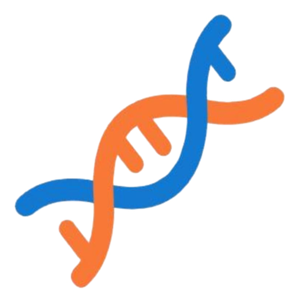
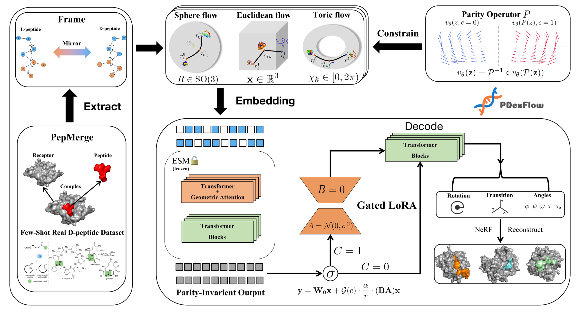

<h1> PDexFlow</h1>

**Escaping the Mirror Trap: Parity-Harmonized Flow Matching on Riemannian Manifolds for Peptide Design** — generate L- and D-peptide binders with symmetry-consistent flow matching and hard geometric constraints.

Official code for the paper accepted at the *International Conference on Data Mining (ICDM) 2026*.

<p align="center">
  
</p>

## Installation

```bash
conda create -n pdexflow python=3.10
conda activate pdexflow
pip install -e ".[dev]"          # add ".[esm]" for the optional frozen ESM-2 receptor features
```

> **Full reproduction of the paper's evaluation requires PyRosetta.** The Rosetta based metrics (Aff., Stb.) need
> [PyRosetta](https://www.pyrosetta.org/) installed separately (it is not a pip dependency of this package; academic use is
> free, commercial use needs a licence). This repository does not run Rosetta itself yet: `pdexflow-eval`
> reports AAR, CA-RMSD, chirality error, novelty and diversity, and reads externally computed Rosetta scores from a CSV
> (`eval.orthogonal`). Clash, SSR, BSR and scRMSD are not implemented (see [docs/paper_mapping.md](docs/paper_mapping.md)).

## Usage

All entry points are [Hydra](https://hydra.cc) apps with default configs in `configs/`; any value can be overridden on the
command line. Data is expected as one folder per complex containing `peptide.pdb` and `pocket.pdb` / `receptor.pdb`
(PepMerge layout). No data at hand? `python scripts/make_toy_dataset.py --out data/toy/pepmerge` creates a tiny synthetic set.

**Train** the backbone (mirror-symmetric strategy, Symmetry Consistency Loss, Mini-ROT)

```bash
pdexflow-train data.structure_dir=data/pepmerge
```

**Fine-tune** Chiral-Bridge LoRA on real D-peptides (backbone frozen)

```bash
pdexflow-finetune data.structure_dir=data/real_d sample.ckpt_path=/path/to/backbone.pt
```

**Generate** (`sample.chirality_token=0` → L-peptide, `1` → D-peptide)

```bash
pdexflow-sample \
    sample.ckpt_path=/path/to/backbone.pt sample.chirality_token=1 sample.num_samples=100
# with LoRA: add  chi_lora=finetune sample.lora_ckpt_path=/path/to/lora.pt
```

**Evaluate** (AAR, CA-RMSD, chirality error, novelty, diversity; Rosetta scores are read from an optional external CSV)

```bash
pdexflow-eval sample.ckpt_path=/path/to/backbone.pt eval.dataset_x_mirror=true
```

**Test** (unit tests plus an end-to-end run of the four entry points on synthetic data, CPU, ~15 s)

```bash
pytest test
```

> Caches built before the parity convention was corrected (the mirrored `*_x_cache.lmdb` files) must be rebuilt once:
> add `data.reset_cache=true`.

How the code maps to the paper, and where it deliberately differs, is documented in [docs/paper_mapping.md](docs/paper_mapping.md).
